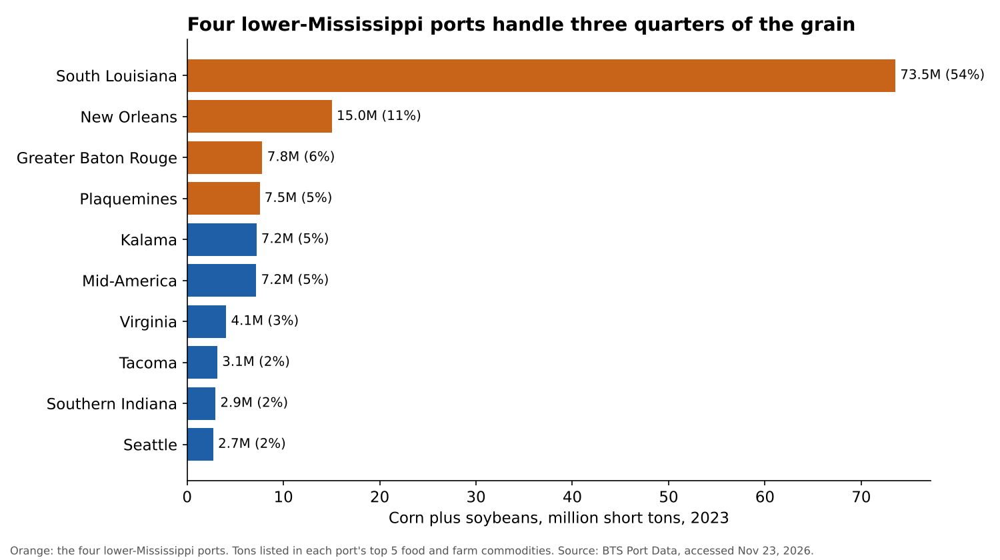
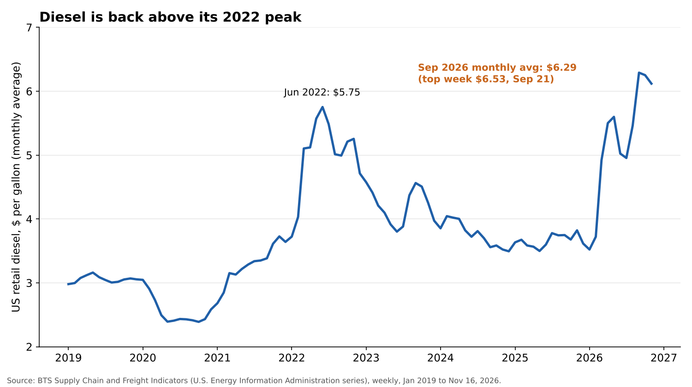

# Book grain barges before harvest: fall barge rates run three times summer's

> I am asking a grain exporter's transportation buyer to contract fall 2027 barge capacity out of St. Louis by July 2027, instead of buying on the spot market at harvest.

**Thomas James**, MBA student, GMBA 634 at Gannon University. I turn public freight data into decisions a manager can act on. This is a class project, not paid or client work.

## The decision, in one picture
A transportation buyer decides each year when to buy barge space to move grain down the Mississippi. From 2019 to 2025, the St. Louis barge rate averaged $9.96 per ton in June and $31.11 in October, 3.1 times as much. October was the most expensive month at all seven origins BTS reports, so space booked early in the summer is the cheaper default.

## The three dataset pages
Each page says who decides what, what one row means, what was done, what the numbers show and what the data cannot show.

| # | Dataset page | Course menu ID | Question it answers | Main chart |
|---|---|---|---|---|
| 1 | [Grain barge rates](./datasets/barge-rates.md) | OP-2 | When is barge space cheap? | [by month](./dashboard/main-chart.png) |
| 2 | [Grain ports](./datasets/grain-ports.md) | OP-3 | Where does the barge grain end up? | [top 10 ports, 2023](./dashboard/grain-ports-chart.png) |
| 3 | [Diesel prices](./datasets/diesel-prices.md) | OP-2 | Is fuel pushing freight costs up again? | [monthly, 2019 to 2026](./dashboard/diesel-chart.png) |

The [live site](https://thomasjamesmu.github.io/gmba634-term-project/) shows all three with interactive charts.

## It is not one bad year
Fall (September to November) cost more than summer (May to July) at St. Louis in 7 of the last 8 years. The exception was 2019, when most summer weeks have no published rate. In 2022 the fall average reached $55.74, 3.95 times that summer's $14.10, and the worst week hit $105.86.

## Where the grain goes, and what fuel costs
In 2023, four lower-Mississippi ports (South Louisiana, New Orleans, Greater Baton Rouge and Plaquemines) handled 75.8% of the corn and soybean tons listed in BTS port data, up from 69.0% in 2020. The barge rate is the price of reaching them.

Fuel is rising at the same time. The US diesel price averaged $6.29 a gallon in September 2026, above the June 2022 peak of $5.75, and October 2026 was 70% above October 2025. Diesel and the St. Louis barge rate have a monthly correlation of 0.46; that is a reason for caution, not proof that diesel drives barge rates.

## How to check my numbers
Every number has one line in the [number trail](./analysis/number-trail.md), with the pivot file it comes from. Each [dataset page](./datasets/) explains its filters and pivots, and [SOURCES](./data/SOURCES.md) lists the publisher, link, date and license for all three.

## What would change my recommendation
I would reverse this recommendation if the forward price offered in July 2027 is above $25.79 per ton, the 2019 to 2025 September to November spot average at St. Louis (in the monthly pivot in the analysis folder).

## AI use disclosure
Claude, an AI assistant, pulled the data from data.bts.gov, filtered and pivoted it with Python, drew the charts, and drafted this README, the site and the dataset pages. I chose the datasets from the course menu and approve what is published here. Every number in this README is checked against the pivot files in the analysis folder. One mistake was fixed before publishing: early on, the AI saved raw data files the course menu marks link-only (for datasets I later dropped) in the repo folder; they were removed before any commit. The charts were made with Python, not Tableau.

## Data and honesty note
- **Sources:** U.S. DOT Bureau of Transportation Statistics. [Supply Chain and Freight Indicators](https://data.bts.gov/d/y5ut-ibwt) (OP-2): "Downbound Grain Barge Rates" (from USDA AMS) and "U.S. Diesel Sales Prices" (from EIA). [Port Data](https://data.bts.gov/d/5rpz-kgm9) (OP-3): corn and soybean tons by port.
- **Accessed:** Nov 23, 2026. **License:** Public Domain U.S. Government.
- **What one row means:** one week's barge spot rate at one of seven river origins (Jan 2019 to Nov 10, 2026); one week's US average diesel price (Jan 2019 to Nov 16, 2026); one port's tons of one commodity in one year (2020 to 2023).
- **What I changed:** dropped blank barge weeks (272 of 2,877), kept only corn and soybean port rows (157), and averaged or summed by month, year and port. The repo holds only these pivot tables, not the full files.
- **What this data cannot show:** contract or forward prices, any firm's own costs, or why rates move. Port tons include imports and domestic cargo, and only top-5 commodities are listed. Diesel is a retail pump price, not marine fuel.

## Contact
Through my GitHub profile: [github.com/thomasjamesmu](https://github.com/thomasjamesmu)
