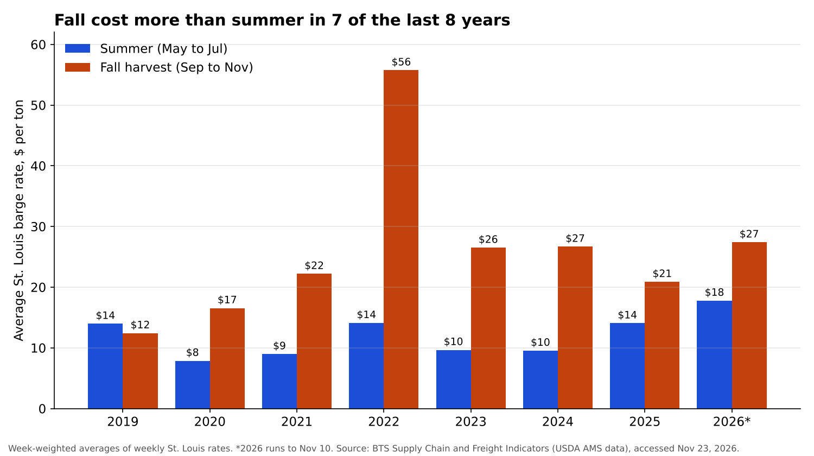

# Book grain barges before harvest: fall barge rates run three times summer's

> I am asking a grain exporter's transportation buyer to contract fall 2027 barge capacity out of St. Louis by July 2027, instead of buying on the spot market at harvest.

**Thomas James**, MBA student, GMBA 634 at Gannon University. I turn public freight data into decisions a manager can act on. This is a class project, not paid or client work.

## The decision, in one picture
A transportation buyer decides each year when to buy barge space to move grain down the Mississippi. From 2019 to 2025, the St. Louis barge rate averaged $9.96 per ton in June and $31.11 in October, 3.1 times as much. October was the most expensive month at all seven origins BTS reports, so space booked early in the summer is the cheaper default.

## The four deliverables
This repository holds all four pieces of my GMBA 634 term project. Start with this list; each line opens one piece.

1. **[Business visualization](./dashboard/main-chart.png)**: barge rates by month. The site adds three more charts: [June versus October by origin](./dashboard/origins-chart.png), [summer versus fall by year](./dashboard/summer-vs-fall-chart.png) and [every month since 2019](./dashboard/st-louis-monthly-chart.png). All are built from BTS data with code; a Tableau Public version is coming.
2. **[Written executive case](./case/executive-case.pdf)**: book fall barge space by July, when rates are seasonally lowest.
3. **[AI/automation component](./ai-component/ai-check.pdf)**: Path B (an AI-assisted step). It covers what the AI did, every number I checked, and where it was wrong.
4. **This site**: [my live site](https://thomasjamesmu.github.io/gmba634-term-project/)

## It is not one bad year
Fall (September to November) cost more than summer (May to July) at St. Louis in 7 of the last 8 years. The exception was 2019, when most summer weeks have no published rate. In 2022 the fall average reached $55.74, 3.95 times that summer's $14.10, and the worst week hit $105.86.

## How to check my numbers
Every number has one line in the [number trail](https://github.com/thomasjamesmu/gmba634-term-project/blob/main/analysis/number-trail.md), with the pivot file and cell it comes from. The [dataset page](https://github.com/thomasjamesmu/gmba634-term-project/blob/main/datasets/barge-rates.md) explains each filter and pivot, and [SOURCES](https://github.com/thomasjamesmu/gmba634-term-project/blob/main/data/SOURCES.md) lists the publisher, link, date and license.

## What would change my recommendation
I would reverse this recommendation if the forward price offered in July 2027 is above $25.79 per ton, the 2019 to 2025 September to November spot average at St. Louis (in the monthly pivot in the analysis folder).

## AI use disclosure
Claude, an AI assistant, downloaded the dataset from data.bts.gov, filtered and pivoted it with Python scripts, drew the charts, and drafted this README, the site, the executive case and the AI check. I chose the dataset from the course menu and approve what is published here. I checked every number in the README against the pivot files in the analysis folder. One mistake was fixed before publishing: early on, the AI saved raw data files the course menu marks link-only (for datasets I later dropped) in the repo folder; they were removed before any commit. The project first also covered port data (OP-3), which I removed to focus on OP-2. Details are in the [AI check](./ai-component/ai-check.pdf). The charts were made with Python, not Tableau.

## Data and honesty note
- **Source:** U.S. DOT Bureau of Transportation Statistics, Supply Chain and Freight Indicators ([data.bts.gov/d/y5ut-ibwt](https://data.bts.gov/d/y5ut-ibwt)), indicator "Downbound Grain Barge Rates", which comes from USDA Agricultural Marketing Service. Course menu ID OP-2.
- **Accessed:** Nov 23, 2026. **License:** Public Domain U.S. Government.
- **What one row means:** one week's spot rate, in dollars per ton, at one of seven river origins, from Jan 2019 to Nov 10, 2026.
- **What I changed:** kept the 2,605 weeks that have a rate (272 of 2,877 are blank) and averaged them by month and by year. The repo holds only these pivot tables, not the full file.
- **What this data cannot show:** contract or forward prices, any firm's own costs, or why rates move. River levels and harvest size are likely causes, but that is reasoning, not a finding here.

## Contact
Through my GitHub profile: [github.com/thomasjamesmu](https://github.com/thomasjamesmu)
