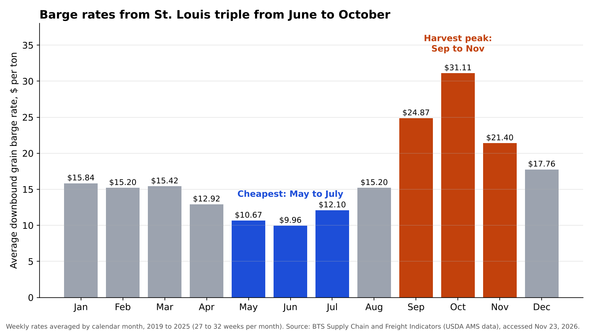
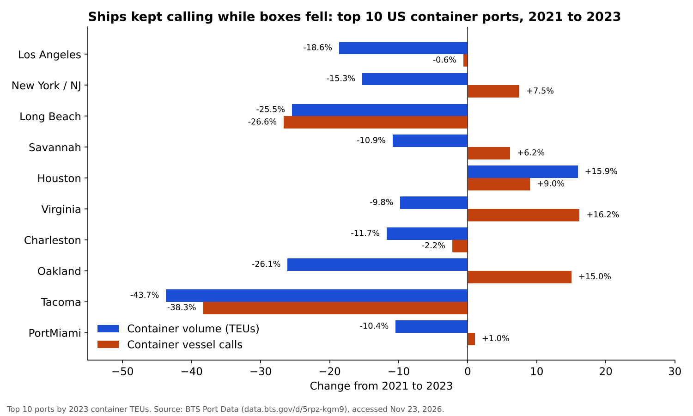

# Freight timing: book barges before harvest, and size port berths by boxes, not ships

> I am asking a grain exporter's transportation buyer to contract fall 2027 barge capacity out of St. Louis by July 2027, instead of buying on the spot market at harvest.

**Thomas James**, MBA student, GMBA 634 at Gannon University. I turn public freight data into decisions a manager can act on. This is a class project, not paid or client work.

## The decision, in one picture
A transportation buyer decides each year when to buy barge space to move grain down the Mississippi. From 2019 to 2025, the St. Louis barge rate averaged $9.96 per ton in June and $31.11 in October, 3.1 times as much. October was the most expensive month at all seven origins BTS reports, so space booked early in the summer is the cheaper default.

## The four deliverables
This repository holds all four pieces of my GMBA 634 term project. Start with this list; each line opens one piece.

1. **[Business visualization](./dashboard/main-chart.png)**: barge rates by month, plus a [second chart on port volume versus ship calls](./dashboard/ports-chart.png). Both are built with Python from BTS data; a Tableau Public version is coming.
2. **[Written executive case](./case/executive-case.pdf)**: book fall barge space by July, and size new container berths by TEU volume, not ship calls.
3. **[AI/automation component](./ai-component/ai-check.pdf)**: Path B (an AI-assisted step). It covers what the AI did, every number I checked, and the two places it was wrong and how I fixed them.
4. **This site**: [my live site](https://thomasjamesmu.github.io/gmba634-term-project/)

## My two datasets
| Menu ID | Dataset | My finding |
|---|---|---|
| OP-2 | BTS Supply Chain and Freight Indicators: Downbound Grain Barge Rates | St. Louis barge rates averaged $9.96 per ton in June and $31.11 in October (2019 to 2025). The October 2022 monthly average hit $89.33. |
| OP-3 | BTS Port Data | At the 10 largest US container ports, container volume fell 16.1% from 2021 to 2023 (36.44 million to 30.57 million TEUs) while container vessel calls rose 2.2% (11,052 to 11,300). |

## Second decision: port berths
> I am asking a port authority's capital planning committee to base its next container-berth expansion on container volume (TEUs), not on the count of ship calls, at its 2027 capital review.

Each call handled fewer containers: TEUs per call at the top 10 ports fell from 3,297 in 2021 to 2,705 in 2023. Houston was the only one of the ten where volume grew.

## What would change my recommendation
I would reverse the barge recommendation if the forward price offered in July 2027 is above $25.79 per ton, the 2019 to 2025 September to November spot average at St. Louis (in the OP-2 monthly pivot). For the ports, I would support expansion where TEU volume returns above its 2021 level while calls keep rising (in the OP-3 pivot).

## AI use disclosure
Claude, an AI assistant, downloaded both datasets from data.bts.gov, filtered and pivoted them with Python scripts, drew both charts, and drafted this README, the executive case and the AI check. I chose the two datasets from the course menu and approve what is published here. I checked every number in the README against the pivot files in the analysis folder. The AI made two mistakes that were fixed before publishing. First, it saved raw data files that the course menu marks link-only (for two datasets I later dropped) in the repo folder; they were removed before any commit. Second, it included small ports whose numbers look like reporting breaks. Details are in the [AI check](./ai-component/ai-check.pdf). The charts were made with Python, not Tableau.

## Data and honesty note
- **OP-2:** U.S. DOT Bureau of Transportation Statistics, Supply Chain and Freight Indicators ([data.bts.gov/d/y5ut-ibwt](https://data.bts.gov/d/y5ut-ibwt)), indicator "Downbound Grain Barge Rates", which comes from USDA Agricultural Marketing Service. Accessed Nov 23, 2026. License: Public Domain U.S. Government. One row is one week's rate in dollars per ton at one of seven river origins, from Jan 2019 to Nov 10, 2026. I kept the 2,605 weeks that have a rate (272 are blank). These are spot market rates: they do not show contract prices or any firm's own costs.
- **OP-3:** U.S. DOT Bureau of Transportation Statistics, Port Data ([data.bts.gov/d/5rpz-kgm9](https://data.bts.gov/d/5rpz-kgm9)). Accessed Nov 23, 2026. License: Public Domain. One row is one port, one year and one cargo measure. I kept container TEUs (trade type TOTAL) and container vessel calls for 2021 and 2023 at the 10 largest ports by 2023 volume. The data end in 2023, calls exist only for 2020 to 2023, and some calls are recorded in halves; I used them as published.
- The repo holds only my pivot tables (in the analysis folder), not the publisher's full files. All findings are verified against those pivots; none are estimated.

## Contact
Through my GitHub profile: [github.com/thomasjamesmu](https://github.com/thomasjamesmu)
